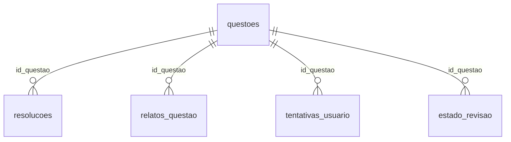

# Dicionário de dados — ENEM GI

> Gerado por `core/gerar_dicionario_dados.py` a partir do schema real. Não edite à mão:
> mude `DESCRICOES` no script e rode de novo. O teste `test_dicionario_dados.py` quebra
> se uma coluna nova entrar no banco sem descrição.

Atualizado em 15/10/2026. Perfil lido do `enem.db` local.

**Classificação:** *pessoal* = dado de uso de uma pessoa, apagado ao criar o banco de um
usuário novo (`criar_banco_usuario.py`); *compartilhado* = conteúdo igual para todos.

## Visão geral

| Tabela | Camada | Classificação | Colunas | Linhas | Para que serve |
|---|---|---|---|---|---|
| `topicos_validos` | referência | compartilhado | 2 | 89 | Taxonomia fechada de matérias aceitas. Espelha TAXONOMIA_VALIDA de db.py; existe para impedir a mesma matéria escrita de dois jeitos. |
| `questoes` | dimensão | compartilhado | 18 | 1.514 | Uma linha por questão: real de prova ENEM ou do banco de prática. Centro do modelo. |
| `resolucoes` | dimensão | compartilhado | 6 | 0 | Resoluções de uma questão (1 questão → N). Hoje guarda texto escrito à mão e as explicações de IA versionadas em explicacoes.jsonl. |
| `relatos_questao` | fato | pessoal | 5 | 22 | Botão 'reportar' do app: sinal de que algo na questão pode estar errado (gabarito, enunciado cortado), para revisar em lote. |
| `eventos` | fato | pessoal | 5 | — | Uso do app (abriu, viu tela, deu erro) para o painel de admin saber quem abriu e travou antes de responder. Sem IP nem User-Agent completo. |
| `tentativas_usuario` | fato | pessoal | 10 | 1.072 | Log de cada resposta dada. Append-only: é o histórico de verdade; só muda por correção de gabarito ou edição explícita, sempre recalculando estado_revisao. |
| `estado_revisao` | estado | pessoal | 5 | 769 | Uma linha por questão já tentada: o ponteiro mutável 'o que revisar hoje', derivado de tentativas_usuario. |
| `historico_alteracoes` | auditoria | pessoal | 7 | 549 | Trilha de auditoria: toda correção de matéria/gabarito (ou questão apagada) depois que a questão já existia. |
| `configuracoes` | configuração | misto (motivo_pessoal, data_inicio_plano são pessoais) | 2 | 3 | Chave-valor de preferências da pessoa (data da prova, início do plano, motivo pessoal). |
| `redacoes` | fato | pessoal | 10 | 1 | Registro de redações. Guarda, não corrige: a nota vem de quem corrigiu. |
| `nomes_tentativas` | configuração | pessoal | 5 | 0 | Rótulo opcional para uma rodada de simulado (ex.: 'fiz cansado'). Não cria a numeração, só nomeia. |

## Relacionamentos

## Alertas de qualidade

Colunas com 50% ou mais de nulos, em tabelas com 20+ linhas. Nem todo nulo é
defeito (ex.: `topico` é opcional de propósito); o alerta é o que vale investigar.

- `questoes.topico` tem 75% de nulos.
- `questoes.enunciado_imagem_path` tem 74% de nulos.
- `tentativas_usuario.tipo_erro` está 100% nula em 1.072 linhas: campo existe, mas ninguém preenche.
- `tentativas_usuario.duracao_segundos` tem 88% de nulos.

## Tabelas

### `topicos_validos`

Taxonomia fechada de matérias aceitas. Espelha TAXONOMIA_VALIDA de db.py; existe para impedir a mesma matéria escrita de dois jeitos.

| Coluna | Tipo | Obrigatória | Chave | Valores permitidos | Descrição | % nulos | Distintos |
|---|---|---|---|---|---|---|---|
| `grande_area` | TEXT | sim | PK | `matematica`, `ciencias_natureza` | Área do ENEM da matéria. | 0% | 2 |
| `materia` | TEXT | sim | PK |  | Matéria normalizada (minúsculo, sem acento, com _). | 0% | 89 |

### `questoes`

Uma linha por questão: real de prova ENEM ou do banco de prática. Centro do modelo.

| Coluna | Tipo | Obrigatória | Chave | Valores permitidos | Descrição | % nulos | Distintos |
|---|---|---|---|---|---|---|---|
| `id_questao` | TEXT | não | PK |  | Chave canônica 'ano_caderno_numero' (ex.: 2024_azul_136), gerada por gerar_id_canonico(). | 0% | 1514 |
| `ano` | INTEGER | sim |  |  | Ano da prova. 0 = sentinela de questão do banco de prática. | 0% | 17 |
| `caderno` | TEXT | sim |  |  | Cor do caderno (azul, amarelo...) ou 'banco_pratica'. | 0% | 4 |
| `numero_questao` | INTEGER | sim |  |  | Número da questão no caderno. | 0% | 357 |
| `grande_area` | TEXT | sim |  |  | Área do ENEM. | 0% | 2 |
| `materia` | TEXT | sim |  |  | Matéria da taxonomia (sem FK de propósito: fora da lista grava como nao_classificado). | 0% | 85 |
| `topico` | TEXT | não |  |  | Subtópico livre, mais fino que a matéria. | 75% | 72 |
| `enunciado_texto` | TEXT | não |  |  | Texto do enunciado e alternativas (PDF do INEP ou API enem.dev). | 4% | 1415 |
| `enunciado_imagem_path` | TEXT | não |  |  | Caminho da figura recortada do PDF/API, quando a questão tem imagem. | 74% | 397 |
| `alternativa_correta` | TEXT | sim |  | `A`, `B`, `C`, `D`, `E` | Gabarito oficial. | 0% | 5 |
| `status_classificacao` | TEXT | sim |  | `classificado`, `nao_classificado` | Se a matéria passou na taxonomia ou espera triagem manual. | 0% | 2 |
| `origem` | TEXT | sim |  | `enem_oficial`, `banco_pratica` | Questão real de prova ou do banco de prática. | 0% | 2 |
| `fonte` | TEXT | não |  |  | De onde veio a questão de prática (gemini, chatgpt, autoral...). Só faz sentido com origem='banco_pratica'. | 50% | 7 |
| `tri_a` | REAL | não |  |  | Parâmetro TRI de discriminação (INEP, ITENS_PROVA). | 25% | 1004 |
| `tri_b` | REAL | não |  |  | Parâmetro TRI de dificuldade (INEP). Base de nivel_tri(): fácil/médio/difícil. | 25% | 1001 |
| `tri_c` | REAL | não |  |  | Parâmetro TRI de acerto ao acaso (INEP). | 25% | 982 |
| `habilidade` | INTEGER | não |  |  | Habilidade H1–H30 da Matriz de Referência (INEP). | 25% | 30 |
| `criado_em` | TEXT | sim |  |  | Quando a linha entrou no banco (hora local). | 0% | 37 |

### `resolucoes`

Resoluções de uma questão (1 questão → N). Hoje guarda texto escrito à mão e as explicações de IA versionadas em explicacoes.jsonl.

| Coluna | Tipo | Obrigatória | Chave | Valores permitidos | Descrição | % nulos | Distintos |
|---|---|---|---|---|---|---|---|
| `id_resolucao` | INTEGER | sim | PK |  | Chave substituta. | — | 0 |
| `id_questao` | TEXT | sim | FK → `questoes.id_questao` |  | Questão resolvida. | — | 0 |
| `tipo` | TEXT | sim |  | `video`, `texto` | Vídeo ou texto. | — | 0 |
| `conteudo` | TEXT | sim |  |  | URL do vídeo ou o texto da resolução. | — | 0 |
| `canal` | TEXT | não |  |  | Origem da resolução (ex.: 'explicacao_ia'). | — | 0 |
| `criado_em` | TEXT | sim |  |  | Quando foi gravada. | — | 0 |

### `relatos_questao`

Botão 'reportar' do app: sinal de que algo na questão pode estar errado (gabarito, enunciado cortado), para revisar em lote.

| Coluna | Tipo | Obrigatória | Chave | Valores permitidos | Descrição | % nulos | Distintos |
|---|---|---|---|---|---|---|---|
| `id_relato` | INTEGER | sim | PK |  | Chave substituta. | 0% | 22 |
| `id_questao` | TEXT | sim | FK → `questoes.id_questao` |  | Questão reportada. | 0% | 22 |
| `comentario` | TEXT | sim |  |  | O que a pessoa achou de errado. | 0% | 22 |
| `resolvido` | INTEGER | sim |  |  | 0 = pendente, 1 = já revisado (o relato não é apagado). | 0% | 2 |
| `criado_em` | TEXT | sim |  |  | Quando foi reportado. | 0% | 22 |

### `eventos`

Uso do app (abriu, viu tela, deu erro) para o painel de admin saber quem abriu e travou antes de responder. Sem IP nem User-Agent completo.

| Coluna | Tipo | Obrigatória | Chave | Valores permitidos | Descrição |
|---|---|---|---|---|---|
| `id_evento` | INTEGER | sim | PK |  | Chave substituta. |
| `tipo` | TEXT | sim |  | `app_aberto`, `tela_vista`, `erro` | app_aberto, tela_vista ou erro (TIPOS_EVENTO). |
| `tela` | TEXT | não |  |  | Rota do app onde aconteceu (ex.: /simulado), sem parâmetro. |
| `aparelho` | TEXT | não |  |  | Sistema e navegador resumidos pelo servidor a partir do User-Agent (ex.: Android · Chrome). |
| `criado_em` | TEXT | sim |  |  | Data/hora local do evento. |

### `tentativas_usuario`

Log de cada resposta dada. Append-only: é o histórico de verdade; só muda por correção de gabarito ou edição explícita, sempre recalculando estado_revisao.

| Coluna | Tipo | Obrigatória | Chave | Valores permitidos | Descrição | % nulos | Distintos |
|---|---|---|---|---|---|---|---|
| `id_tentativa` | INTEGER | sim | PK |  | Chave substituta. | 0% | 1072 |
| `id_questao` | TEXT | sim | FK → `questoes.id_questao` |  | Questão respondida. | 0% | 769 |
| `data_tentativa` | TEXT | sim |  |  | Data/hora local da resposta (local, não UTC — ver comentário no schema). | 0% | 277 |
| `resposta_escolhida` | TEXT | não |  | `A`, `B`, `C`, `D`, `E`, `NULL` | Letra marcada. NULL = deixou em branco (conta como erro). | 8% | 5 |
| `resultado` | TEXT | sim |  | `acertou`, `errou` | Calculado contra o gabarito, nunca digitado. | 0% | 2 |
| `intervalo_dias` | INTEGER | sim |  |  | Intervalo Leitner calculado nesta tentativa. | 0% | 4 |
| `streak_acertos` | INTEGER | sim |  |  | Acertos seguidos até esta tentativa. | 0% | 5 |
| `proxima_revisao` | TEXT | sim |  |  | Data em que a questão volta para revisão. | 0% | 34 |
| `tipo_erro` | TEXT | não |  |  | Por que errou: erro_de_conta, erro_de_pegadinha ou erro_de_conteudo (TIPOS_ERRO). Opcional. | 100% | 0 |
| `duracao_segundos` | INTEGER | não |  |  | Tempo gasto na questão, quando cronometrado. | 88% | 72 |

### `estado_revisao`

Uma linha por questão já tentada: o ponteiro mutável 'o que revisar hoje', derivado de tentativas_usuario.

| Coluna | Tipo | Obrigatória | Chave | Valores permitidos | Descrição | % nulos | Distintos |
|---|---|---|---|---|---|---|---|
| `id_questao` | TEXT | não | PK |  | Questão. | 0% | 769 |
| `intervalo_dias` | INTEGER | sim |  |  | Intervalo Leitner atual. | 0% | 4 |
| `streak_acertos` | INTEGER | sim |  |  | Acertos seguidos atuais. | 0% | 5 |
| `proxima_revisao` | TEXT | sim |  |  | Próxima data de revisão. | 0% | 29 |
| `ultima_tentativa` | TEXT | sim |  |  | Data da última resposta. | 0% | 27 |

### `historico_alteracoes`

Trilha de auditoria: toda correção de matéria/gabarito (ou questão apagada) depois que a questão já existia.

| Coluna | Tipo | Obrigatória | Chave | Valores permitidos | Descrição | % nulos | Distintos |
|---|---|---|---|---|---|---|---|
| `id` | INTEGER | sim | PK |  | Chave substituta. | 0% | 549 |
| `id_questao` | TEXT | sim |  |  | Questão alterada (sem FK: precisa sobreviver à questão apagada). | 0% | 484 |
| `campo` | TEXT | sim |  |  | Campo alterado (materia, alternativa_correta, questao_apagada). | 0% | 3 |
| `valor_antigo` | TEXT | não |  |  | Valor antes da correção. | 0% | 123 |
| `valor_novo` | TEXT | não |  |  | Valor depois da correção. | 0% | 76 |
| `data_alteracao` | TEXT | sim |  |  | Quando foi corrigido. | 0% | 26 |
| `tentativas_recalculadas` | INTEGER | sim |  |  | Quantas tentativas tiveram o resultado recalculado por causa da correção. | 0% | 2 |

### `configuracoes`

Chave-valor de preferências da pessoa (data da prova, início do plano, motivo pessoal).

| Coluna | Tipo | Obrigatória | Chave | Valores permitidos | Descrição | % nulos | Distintos |
|---|---|---|---|---|---|---|---|
| `chave` | TEXT | não | PK |  | Nome da configuração. | 0% | 3 |
| `valor` | TEXT | sim |  |  | Valor em texto. | 0% | 3 |

### `redacoes`

Registro de redações. Guarda, não corrige: a nota vem de quem corrigiu.

| Coluna | Tipo | Obrigatória | Chave | Valores permitidos | Descrição | % nulos | Distintos |
|---|---|---|---|---|---|---|---|
| `id` | INTEGER | sim | PK |  | Chave substituta. | 0% | 1 |
| `tema` | TEXT | sim |  |  | Tema da redação. | 0% | 1 |
| `data_escrita` | TEXT | sim |  |  | Dia em que foi escrita. | 0% | 1 |
| `texto` | TEXT | não |  |  | Texto digitado, se houver. | 100% | 0 |
| `arquivo_path` | TEXT | não |  |  | Foto/PDF da redação manuscrita, se houver. | 100% | 0 |
| `nota` | INTEGER | não |  |  | Nota de 0 a 1000. NULL = ainda não corrigida. | 0% | 1 |
| `erros_ortograficos` | INTEGER | não |  |  | Contagem de erros apontada na correção. | 100% | 0 |
| `fonte_correcao` | TEXT | não |  | `propria`, `externa`, `oficial`, `NULL` | Quem corrigiu: a própria pessoa, externa ou oficial. | 0% | 1 |
| `observacoes` | TEXT | não |  |  | Comentários da correção. | 0% | 1 |
| `criado_em` | TEXT | sim |  |  | Quando foi registrada. | 0% | 1 |

### `nomes_tentativas`

Rótulo opcional para uma rodada de simulado (ex.: 'fiz cansado'). Não cria a numeração, só nomeia.

| Coluna | Tipo | Obrigatória | Chave | Valores permitidos | Descrição | % nulos | Distintos |
|---|---|---|---|---|---|---|---|
| `ano` | INTEGER | sim | PK |  | Ano da prova. | — | 0 |
| `caderno` | TEXT | sim | PK |  | Caderno. | — | 0 |
| `grande_area` | TEXT | sim | PK |  | Área. | — | 0 |
| `numero_tentativa` | INTEGER | sim | PK |  | Nº da rodada, o mesmo que resumo_por_tentativa() deriva com ROW_NUMBER. | — | 0 |
| `nome` | TEXT | sim |  |  | Rótulo livre. | — | 0 |
